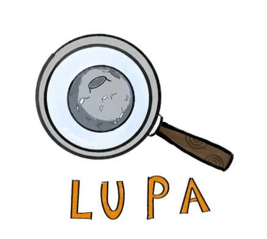
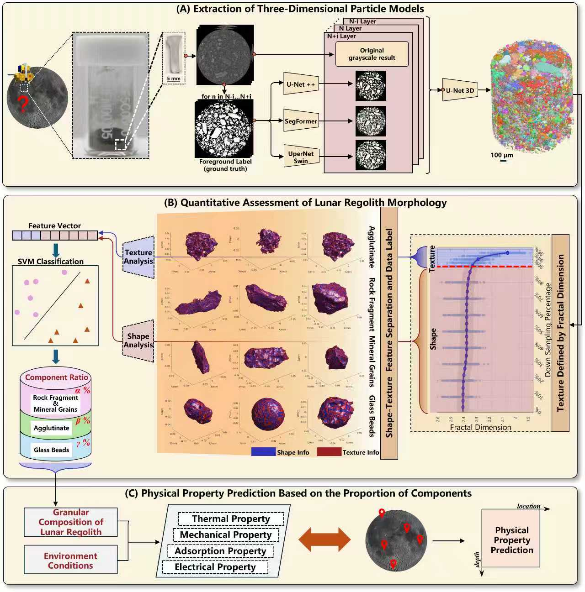

# LUPA: Lunar Regolith Particle Analyzer

[![Contributors][contributors-shield]][contributors-url]
[![Forks][forks-shield]][forks-url]
[![Stars][stars-shield]][stars-url]
[![Issues][issues-shield]][issues-url]

<p align="center">
  
</p>

**LUPA** is a Python toolkit for batch analysis of lunar regolith particle morphology and surface texture. It reads particle STL meshes, extracts the main connected surface, simplifies the mesh, computes geometric descriptors, and exports results and figures. Version 1.0 provides a command-line interface and an English-language Windows desktop interface.

## Contents

- [Features](#features)
- [Related project](#related-project)
- [Installation](#installation)
- [Usage](#usage)
- [Input and configuration](#input-and-configuration)
- [Results](#results)
- [Project structure](#project-structure)
- [Tests](#tests)
- [Developers](#developers)
- [License and acknowledgements](#license-and-acknowledgements)

## Features

- **Mesh preprocessing:** read ASCII and binary STL files, merge coincident vertices, remove identical face entries and zero-area faces, and retain the connected surface with the largest area.
- **Mesh simplification:** use PyMeshLab quadric edge collapse with a specified target face-retention ratio.
- **Morphology:** calculate equivalent-volume diameter, specific surface area, Wadell sphericity, PCA axis ratios, and radial-distance variance.
- **Surface texture:** calculate vertex-to-surface roughness and estimate surface fractal dimension through voxelization and multiscale spherical dilation.
- **Batch processing:** process particles with one or multiple worker processes; run preprocessing, analysis, and display together or as separate stages.
- **Results:** export CSV and JSON tables, STL and NPZ meshes, and PNG mesh views and fractal-fit plots.

The workflow is **STL input → connected-surface extraction → mesh simplification → descriptor calculation → tables and figures**. The runtime is entirely Python.

### Research framework

The figure shows the research workflow from CT-based particle reconstruction to morphology and texture analysis, particle classification, and physical-property prediction. LUPA provides the mesh preprocessing and quantitative morphology and surface-texture analysis used within this workflow.

<p align="center">
  
</p>

## Related project

**Lunar Regolith Atlas** presents lunar regolith particle results generated using the LUPA calculation package.

- **Interactive website:** [Lunar Regolith Atlas](https://wanglingxin-hit.github.io/lunar-regolith-atlas/)
- **Source code:** [WangLingxin-hit/lunar-regolith-atlas](https://github.com/WangLingxin-hit/lunar-regolith-atlas)

## Installation

Use Python 3.11. The desktop interface uses Tkinter and Tcl/Tk; PNG preview and opening the results folder use Windows file associations.

```sh
git clone https://github.com/Catsup0059/LUPA-Lunar-Regolith-Particle-Analyzer.git
cd LUPA-Lunar-Regolith-Particle-Analyzer
conda create -n lupa python=3.11 tk
conda activate lupa
python -m pip install -r requirements.txt
```

The verified environment is Windows 11, Python 3.11.13, NumPy 1.26.4, SciPy 1.11.4, Matplotlib 3.10.3, and PyMeshLab 2025.7.post1. Dependency version ranges are defined in [requirements.txt](requirements.txt).

## Usage

The default [analysis.ini](analysis.ini) processes three synthetic meshes in [examples/stl](examples/stl): a sphere, an ellipsoid, and a rough particle. The sphere also contains a separate internal tetrahedron to demonstrate connected-surface extraction.

### Desktop interface

```sh
python main.py --gui
```

Select **STL input folder** and **Output folder**, set **Face retention**, **Result tag**, **Workers**, and **Voxel size (mm)**, then select the metrics and click **Start analysis**. The interface displays progress, a result table, and a run log. **Preview particle** opens the selected particle image; **Open results** opens the exported results.

Changes made in the interface apply to that run. The INI file stays unchanged, and the result JSON records the effective settings. Desktop runs export figures as PNG files.

### Command-line interface

```sh
python main.py --config analysis.ini
python main.py --config analysis.ini --workers 2
```

To execute the stages separately, run them in this order:

```sh
python main.py --config analysis.ini --stage preprocess
python main.py --config analysis.ini --stage analyze
python main.py --config analysis.ini --stage display
```

`preprocess` reads STL files and saves repaired and simplified meshes. `analyze` reads the saved meshes and computes the selected metrics. `display` reads the saved meshes and generates their views. For all command-line options, run `python main.py --help`.

## Input and configuration

Each STL file represents one particle. Volume-based metrics use a closed triangular surface with consistently oriented faces. Connected-surface extraction retains the component with the largest surface area; hole filling and non-manifold reconstruction are outside this operation.

Edit [analysis.ini](analysis.ini) to select directories, metrics, and algorithm parameters. Relative paths are resolved from the INI file's directory.

| Section and setting | Default | Meaning |
| --- | --- | --- |
| `RepairStl.InputDir` | `examples/stl` | Input particle STL directory |
| `ImportObject.ReshapeToCenter` | `1` | Center the retained mesh and record its original coordinate offset |
| `FilterStl.Percent` | `0.5` | Target fraction of triangle faces retained after simplification |
| `FilterStl.PercentDescription` | `05` | String tag used to pair repaired and simplified meshes; leading zeros are preserved |
| `Analysis.Workers` | `1` | Number of worker processes; `--workers` overrides this setting |
| `Analysis.Neighbors` | `10` | Nearest simplified-mesh vertices used to select candidate faces for roughness |
| `Analysis.EquivalentDiameter`, `Wadell`, `PCA`, `ShapeVariance`, `Roughness` | `true` | Enable the corresponding metric groups |
| `Analysis.Fractal`, `FilterFractal` | `false` | Enable fractal analysis of the repaired and simplified meshes |
| `Fractal.VoxelSize` | `0.001` | Voxel size in millimetres; `auto` selects the size from the particle dimensions |
| `Fractal.Radii` | `auto` | Generate 35 dilation radii; an explicit list uses comma-separated values in millimetres |
| `Display.Shade` | `solid` | Mesh display mode: `solid`, `mesh` (wireframe), or `both` |
| `Display.Export` | `png` | CLI figure destination: `png`, `screen`, or `both` |

Geometric lengths use the STL coordinate unit, areas use its square, and volumes use its cube. For fractal analysis, supply STL coordinates and dilation parameters in millimetres. STL files contain no unit metadata.

NPZ meshes store `vertices`, zero-based `faces`, and `origin`; input coordinates are recovered as `vertices + origin`. Repaired and simplified meshes share a coordinate system. Analysis and display also read paired MATLAB MAT meshes containing these arrays, with one-based face indices converted on import; format details are in [MIGRATION.md](MIGRATION.md).

## Results

The default CLI configuration writes mesh data to `data/obj_data`, STL files to `data/stl`, result tables to `data/result`, and mesh images to `picture`. Desktop runs organize the selected output root into `stl`, `meshes`, `results`, and `images` directories.

Each CSV row contains a particle name and 13 metrics. CSV files use UTF-8 with a byte-order mark. JSON files include the same measurements, software version, timestamp, enabled metric groups, and effective settings.

| Field | Definition | Unit |
| --- | --- | --- |
| `d_v` | Equivalent-volume diameter of the repaired mesh | Length |
| `SSA` | Repaired-mesh surface area divided by volume | Inverse length |
| `Wadell` | Equal-volume sphere area divided by simplified-mesh surface area | Dimensionless |
| `EI` | Intermediate/longest PCA-axis span, I/L | Dimensionless |
| `FI` | Shortest/intermediate PCA-axis span, S/I | Dimensionless |
| `AR` | Shortest/longest PCA-axis span, S/L | Dimensionless |
| `shape_variance` | Sample variance of repaired-vertex distances from the current coordinate origin | Length squared |
| `Ra` | Mean absolute distance from repaired vertices to simplified-surface candidate faces | Length |
| `Rz` | Sample standard deviation of those distances, using `ddof=1` | Length |
| `D_repair` | Fractal dimension estimated from the repaired mesh | Dimensionless |
| `Rsq_repair` | R² of the repaired-mesh log–log dilation fit | Dimensionless |
| `D_filter` | Fractal dimension estimated from the simplified mesh | Dimensionless |
| `Rsq_filter` | R² of the simplified-mesh log–log dilation fit | Dimensionless |

PCA axis ratios use the repaired mesh. Roughness computes the exact point-to-triangle distance within faces attached to the selected nearest vertices. Fractal analysis approximates the surface with voxels near mesh vertices and fits `D = 3 - slope` to dilation volume against radius in log–log coordinates. Its outputs include the sampled radii, volumes, fit data, and a PNG fit plot.

Disabled metrics occupy zero-valued fields in CSV and JSON; `enabled_metrics` in JSON identifies the computed groups. The desktop table displays `--` for disabled metrics.

## Project structure

```text
main.py                 Application entry point
analysis.ini            Input paths and analysis parameters
requirements.txt        Python dependencies
lupa/                   Mesh, metric, fractal, rendering, pipeline, CLI, and GUI modules
examples/               Synthetic STL meshes and their generator
tests/                  Mesh and pipeline tests
license/                Project and dependency license texts
MIGRATION.md            MATLAB-to-Python function mapping and data-format notes
THIRD_PARTY_NOTICES.md   Dependency attribution and license inventory
```

## Tests

```sh
python -m unittest discover -s tests -v
```

The 12 tests cover ASCII and binary STL, connected-surface extraction, coordinate offsets, geometric and texture metrics, result export, MAT import, and consistency between single-process and multiprocess execution. Regenerate the synthetic examples with:

```sh
python examples/create_demo.py
```

## Developers

LUPA is developed by the following contributors:

<table>
  <tr>
    <td align="center" width="160">
      <a href="https://github.com/Catsup0059">
        <br>
        <strong>Catsup0059</strong>
      </a>
    </td>
    <td align="center" width="160">
      <a href="https://github.com/WangLingxin-hit">
        <br>
        <strong>WangLingxin-hit</strong>
      </a>
    </td>
  </tr>
</table>

Contributors are also listed on the repository's [contributors page][contributors-url].

## License and acknowledgements

LUPA is licensed under **GNU Affero General Public License v3.0 or later (AGPL-3.0-or-later)**. The full license text is in [LICENSE.txt](LICENSE.txt).

LUPA uses NumPy and SciPy for numerical operations, Matplotlib for figures, and PyMeshLab for mesh simplification. Their authors and license texts are listed in [THIRD_PARTY_NOTICES.md](THIRD_PARTY_NOTICES.md).

The earlier MATLAB workflow used SPHARM-MAT, developed by ShenLab at Indiana University, and point2trimesh by Daniel Frisch. This Python implementation performs STL handling and point-to-triangle distance calculations in the `lupa` modules. SPHARM-MAT and point2trimesh are historical references and are not bundled runtime dependencies.

[contributors-shield]: https://img.shields.io/github/contributors/Catsup0059/LUPA-Lunar-Regolith-Particle-Analyzer.svg?style=flat-square
[contributors-url]: https://github.com/Catsup0059/LUPA-Lunar-Regolith-Particle-Analyzer/graphs/contributors
[forks-shield]: https://img.shields.io/github/forks/Catsup0059/LUPA-Lunar-Regolith-Particle-Analyzer.svg?style=flat-square
[forks-url]: https://github.com/Catsup0059/LUPA-Lunar-Regolith-Particle-Analyzer/forks
[stars-shield]: https://img.shields.io/github/stars/Catsup0059/LUPA-Lunar-Regolith-Particle-Analyzer.svg?style=flat-square
[stars-url]: https://github.com/Catsup0059/LUPA-Lunar-Regolith-Particle-Analyzer/stargazers
[issues-shield]: https://img.shields.io/github/issues/Catsup0059/LUPA-Lunar-Regolith-Particle-Analyzer.svg?style=flat-square
[issues-url]: https://github.com/Catsup0059/LUPA-Lunar-Regolith-Particle-Analyzer/issues
